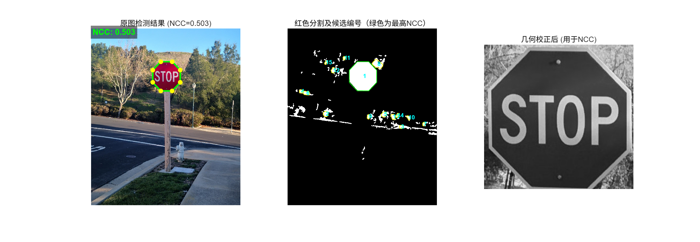

# STOP 标志识别 · MATLAB

数字图像处理课程小组项目。使用传统图像处理方法，在图像中定位 STOP 交通标志，并输出候选顶点、匹配分数及可视化结果。

代码按最终提交目录 `Project1_Submission/source_code` 整理；报告与演示文稿保留在 `docs/`。小组成员与个人分工请以原始文档为准，本文不将整个项目归为个人独立完成。

## 方法

1. HSV/RGB 阈值和形态学操作提取红色区域。
2. 凸包、形状和几何约束筛选八边形候选。
3. 将候选区域透视校正到模板坐标系。
4. 计算八边形内部与中央文字区域的归一化互相关（NCC）。
5. 根据匹配分数与辅助判据输出检测结果。

## 结果预览

以下图片来自现有提交文件夹，是历史运行结果。本次仓库整理没有重新执行检测，也未确认图片与当前源码逐一对应；不据此宣称独立测试准确率。



[全部现有结果图片](examples/) · [课程报告](docs/report.docx) · [演示文稿](docs/presentation.pptx) · [源码说明](docs/source-code-description.pdf)

## 环境与运行

- MATLAB 与 Image Processing Toolbox。
- 版本需支持 `fitgeotform2d`；本次整理未测定最低兼容版本。
- 保持模板、顶点文件、源码与 `test images/` 的相对位置。

在 MATLAB 中将当前文件夹切换到仓库根目录，运行：

```matlab
main_stop_detection
```

程序读取 `test images/` 中的图片，并将本次生成的结果保存到 `results/`。该目录由 Git 忽略，已有展示图单独保存在 `examples/`。

已提供 `template_stop.jpg` 与 `template_points.mat`。如需重新标注模板，请在仓库根目录运行 `manual_template_points`，按顺序点击八个角点；这会覆盖根目录中的顶点文件。

## 主要文件

| 文件 | 作用 |
|---|---|
| `main_stop_detection.m` | 批量检测入口、参数和结果展示 |
| `red_segmentation.m` | 红色区域分割 |
| `find_octagon_candidates.m` | 八边形候选筛选 |
| `detect_stop_sign.m` | 候选校正、匹配与选择 |
| `rectify_octagon.m` | 透视变换 |
| `compute_ncc_with_mask.m` | 带掩码的相关性评分 |
| `manual_template_points.m` | 模板顶点标注 |
| `extract_octagon_vertices.m` | 保留的辅助函数 |

## 判据与局限

常规判据为综合分数 ≥ 0.30；低分候选在综合分数 ≥ 0.25、文字区分数 ≥ 0.25、红色占比 ≥ 0.60 同时成立时，也可由辅助规则通过。NCC 不是概率意义上的置信度。

阈值和规则针对有限课程样例开发，不能将这些样例的表现等同于独立测试的泛化能力。复杂背景、光照、遮挡和字形变化仍可能影响效果。保留原始报告，便于结合实际开发过程理解结果。

## 资料与使用

这是课程项目的归档与展示副本；没有另行授予开源许可证。输入样例、团队文档及第三方资料的权利归原权利人。项目整理记录见 [ARCHIVE_NOTES.md](ARCHIVE_NOTES.md)。
